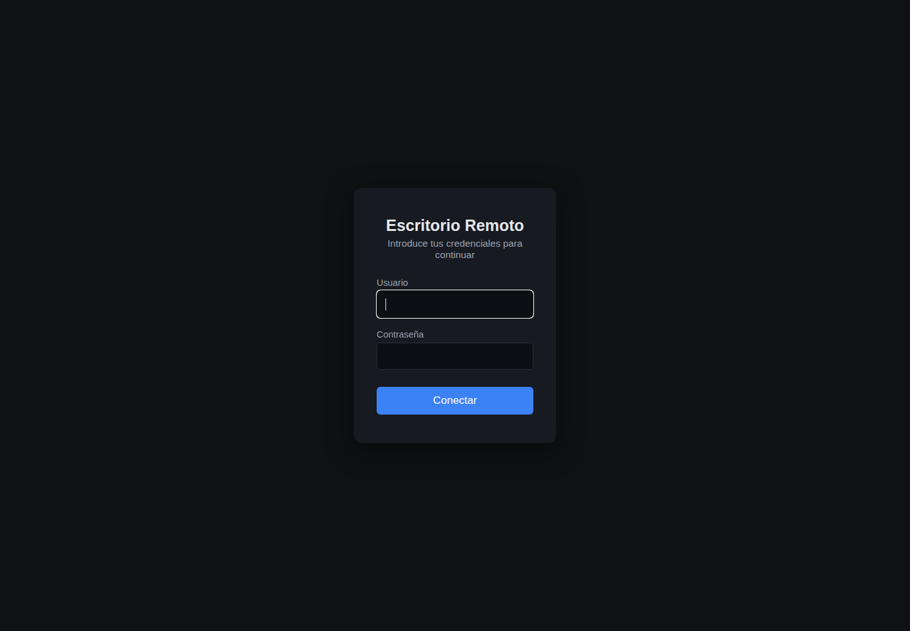
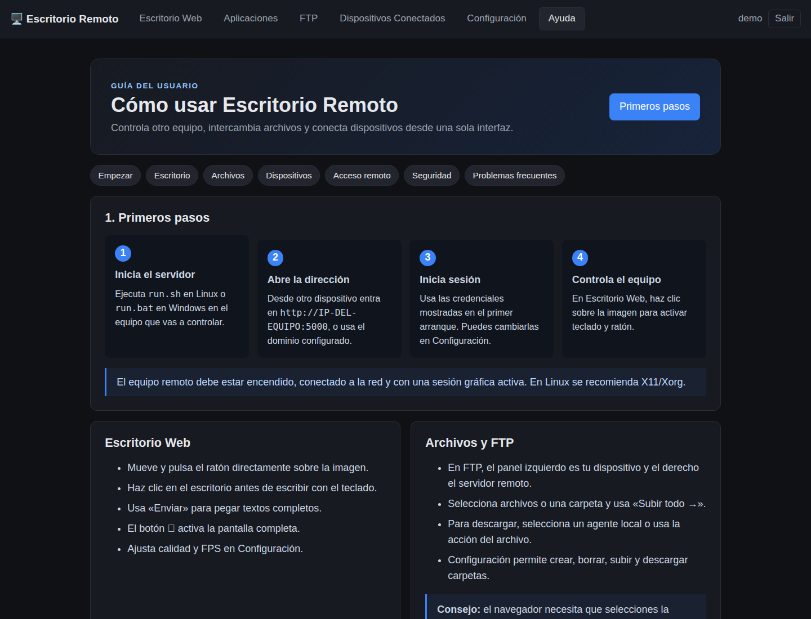
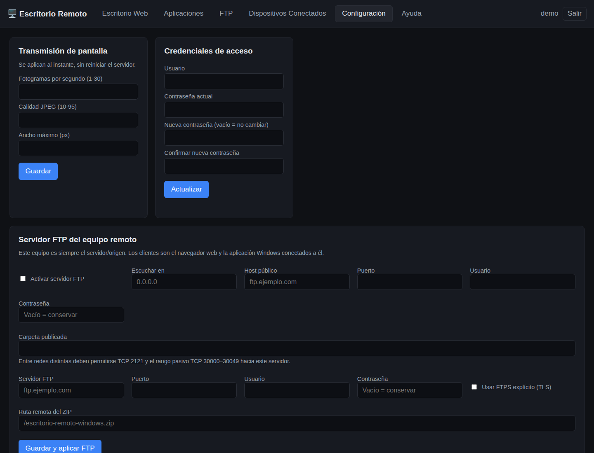

# Escritorio Remoto Bravo

Aplicación web en **Flask + Flask-SocketIO** que convierte cualquier
ordenador (Windows o Ubuntu/Linux) en un servidor de escritorio remoto
accesible desde un navegador. Permite ver la pantalla en tiempo real y
controlar el mouse y el teclado de forma remota, por ejemplo a través de un
dominio/túnel como `remoto.example.com`.

A diferencia del "Escritorio remoto" nativo de Windows (RDP), **no requiere
abrir el puerto 3389 ni habilitar RDP en el sistema**: solo necesita que el
puerto HTTP/WebSocket de esta app (por defecto `5000`) sea alcanzable desde
donde te conectes (directamente, por VPN, o detrás de un reverse proxy /
túnel HTTPS propio).

[Guía completa para el usuario](docs/GUIA_USUARIO.md) · [Seguridad](SECURITY.md) · [Cómo contribuir](CONTRIBUTING.md)

## Capturas

| Inicio de sesión | Ayuda integrada |
|---|---|
|  |  |



## Características

- Streaming de pantalla en vivo (todos los monitores combinados) vía
  WebSocket, con FPS y calidad JPEG configurables.
- Control remoto de mouse (movimiento, clic izq./medio/der., rueda) y
  teclado (teclas especiales + texto). Cursor en forma de flecha al mover
  y de mano al hacer clic, como cualquier escritorio.
- Caja de "enviar texto" para pegar/escribir texto completo de una vez.
- **Pestaña "Configuración"** con:
  - Ajustes de streaming (FPS, calidad JPEG, ancho máximo) aplicados al
    instante, sin reiniciar el servidor.
  - Cambio de usuario/contraseña desde la propia interfaz.
  - **Gestor de archivos** (subida/descarga de archivos y carpetas,
    descarga de carpetas como `.zip`, crear/borrar), equivalente a un
    cliente FTP pero integrado en la misma conexión HTTPS ya autenticada.
  - **Generador de subdominios con Cloudflare Tunnel**: indicas un
    hostname (`subdominio.dominio.tld`, válido para cualquier TLD
    registrado en tu cuenta de Cloudflare) y, con un clic en
    "Generar y Configurar", la app crea el registro DNS, añade la regla
    de enrutamiento y reinicia el túnel automáticamente.
  - **Descarga de la aplicación en `.zip`** para instalarla en otro
    equipo (Windows o Ubuntu).
  - **Pestaña "Escritorio Windows"** con cliente nativo empaquetado como `.exe`
    (Electron, sin Python) y transferencia FTP híbrida: servidor local o descarga
    desde un FTP remoto.
  - **Gestor FTP de doble panel**, similar a FileZilla: dos conexiones FTP/FTPS
    independientes, navegación por directorios y arrastre de archivos o carpetas
    de un servidor al otro.
- Login con usuario/contraseña; contraseña generada automáticamente en el
  primer arranque (o configurable).
- 100 % multiplataforma: mismo código para Windows y Ubuntu/Linux (usa
  `mss` para capturar pantalla y `pynput` para controlar mouse/teclado).
- Pensado para ejecutarse como servicio/arranque automático en cualquiera
  de los dos sistemas operativos.

## Requisitos

- Python 3.9 o superior.
- Una sesión de escritorio gráfica activa en el equipo servidor:
  - Windows: cualquier sesión de usuario normal.
  - Linux: sesión **X11** (Xorg). Wayland no es compatible de forma nativa
    por las restricciones de captura/control de entrada; si tu Ubuntu usa
    Wayland por defecto, selecciona "Ubuntu sobre Xorg" en la pantalla de
    inicio de sesión.

### ⚠️ Importante: desactiva la suspensión automática

Si el equipo servidor **se suspende por inactividad**, se desconecta de la
red y deja de ser accesible (también la app y el túnel). Desactiva la
suspensión automática en el equipo que va a actuar como servidor:

**Ubuntu/GNOME:**
```bash
gsettings set org.gnome.settings-daemon.plugins.power sleep-inactive-ac-type 'nothing'
gsettings set org.gnome.settings-daemon.plugins.power sleep-inactive-battery-type 'nothing'
```

**Windows:** en *Configuración > Sistema > Energía y batería*, pon
"Suspensión" en "Nunca".

El **bloqueo de pantalla** puede dejarse activado: en Linux/X11 la app
escribe mediante XTest (como un teclado físico), así que puedes introducir
la contraseña de la pantalla de bloqueo y de los cuadros
"Se necesita autenticación" (contraseña de administrador) desde el
navegador remoto.

> En **Windows**, las ventanas de UAC ("¿Quieres permitir que esta
> aplicación haga cambios...?") y la pantalla de inicio de sesión se
> muestran en el *escritorio seguro*, que por diseño no acepta entrada de
> aplicaciones normales. Para controlarlas, la app tendría que ejecutarse
> como servicio de sistema (SYSTEM), o bien configura UAC para no atenuar
> el escritorio ("Notificarme solo cuando una aplicación intente realizar
> cambios (no atenuar el escritorio)").

## Instalación

### Agente local de dispositivos

Para mostrar datos reales de cada ordenador sin depender del navegador, abre
**Dispositivos Conectados > Instalar agente local en otro ordenador**. Descarga
`device_agent.py` y `agent-requirements.txt`; la propia pantalla genera el
comando autenticado para ese servidor.

```bash
python -m venv venv-agent
# Linux/macOS: venv-agent/bin/pip install -r agent-requirements.txt
# Windows: venv-agent\Scripts\pip install -r agent-requirements.txt
python device_agent.py --server https://servidor.example --token TOKEN
```

El agente publica hostname, usuario del sistema, IP local, máscara, puerta de
enlace, interfaz activa y SSID. En Linux puede instalarse como servicio usando
`deploy/escritorio-remoto-agent.service` y las variables `RDWEB_AGENT_SERVER`
y `RDWEB_AGENT_TOKEN` en `/etc/escritorio-remoto-agent.env`.

### Linux / Ubuntu

```bash
git clone https://github.com/robotcamptecnologico-gif/escritorio-remoto-bravo.git escritorio-remoto
cd escritorio-remoto
./run.sh
```

`run.sh` crea un entorno virtual en `venv/`, instala las dependencias de
`requirements.txt` y arranca el servidor. En el primer arranque se imprime
en consola un usuario y contraseña generados automáticamente.

### Windows

```bat
git clone https://github.com/robotcamptecnologico-gif/escritorio-remoto-bravo.git escritorio-remoto
cd escritorio-remoto
run.bat
```

`run.bat` hace lo mismo que `run.sh` pero usando `venv\Scripts\python.exe`.

### Instalación manual (ambos sistemas)

```bash
python -m venv venv
# Linux/macOS:
source venv/bin/activate
# Windows:
venv\Scripts\activate

pip install -r requirements.txt
python app.py
```

## Primer arranque y credenciales

Al iniciar por primera vez, si no existen credenciales se genera una
contraseña aleatoria y se muestra una sola vez en consola:

```
================================================================
 Se generó una contraseña de acceso automáticamente.
   Usuario:    admin
   Contraseña: Xy7f9QwErT2a
 Guárdala en un lugar seguro: no volverá a mostrarse.
 Para cambiarla más adelante ejecuta:
   python app.py --set-password
================================================================
```

Las credenciales quedan guardadas (hash de la contraseña, nunca en texto
plano) en `instance/config.json`.

Para definirlas tú mismo en el primer arranque, usa variables de entorno:

```bash
RDWEB_USERNAME=miusuario RDWEB_PASSWORD=micontraseña python app.py
```

Para cambiarlas más adelante:

```bash
python app.py --set-password
```

## Configuración (variables de entorno)

La mayoría de estos ajustes también pueden cambiarse desde la pestaña
**Configuración** de la app (quedan guardados en `instance/config.json`).
Si defines la variable de entorno correspondiente, esta tiene prioridad
sobre lo guardado en ese arranque concreto:

| Variable                     | Por defecto        | Descripción                                    |
|-------------------------------|--------------------|-------------------------------------------------|
| `RDWEB_HOST`                  | `0.0.0.0`          | Dirección donde escucha el servidor              |
| `RDWEB_PORT`                  | `5000`             | Puerto HTTP/WebSocket                            |
| `RDWEB_FPS`                   | `12`               | Fotogramas por segundo del streaming             |
| `RDWEB_QUALITY`               | `50`               | Calidad JPEG (1-95); menor = más rápido          |
| `RDWEB_MAX_WIDTH`             | `1600`             | Ancho máximo de los frames enviados al cliente   |
| `RDWEB_FILE_ROOT`             | carpeta del usuario | Raíz del gestor de archivos (transferencia tipo FTP) |
| `RDWEB_CF_TUNNEL`             | *(autodetectado)*  | Nombre/ID del túnel de Cloudflare                |
| `RDWEB_CF_CONFIG`             | *(autodetectado)*  | Ruta del YAML de ingress del túnel               |
| `RDWEB_CF_SERVICE`            | *(vacío)*          | Nombre del servicio a reiniciar tras configurar   |
| `RDWEB_CF_RESTART`            | *(según SO)*       | `systemd-user`, `systemd-system`, `windows-service` o `manual` |
| `RDWEB_CF_BINARY`             | *(autodetectado)*  | Ruta del ejecutable `cloudflared`                |
| `RDWEB_FTP_MODE`              | `server`           | Modo FTP: `server` o `client`                    |
| `RDWEB_FTP_SERVER_ENABLED`    | `false`            | Publica el paquete Windows mediante FTP           |
| `RDWEB_FTP_SERVER_HOST/PORT`  | `0.0.0.0` / `2121` | Dirección y puerto del servidor FTP               |
| `RDWEB_FTP_SERVER_USER/PASSWORD` | `remote` / vacío | Credenciales del servidor FTP                    |
| `RDWEB_FTP_CLIENT_HOST/PORT`  | vacío / `21`       | Servidor FTP del que recuperar el paquete         |
| `RDWEB_FTP_CLIENT_USER/PASSWORD` | `anonymous` / vacío | Credenciales del cliente FTP                  |
| `RDWEB_FTP_CLIENT_TLS`        | `false`            | Usa FTPS explícito para la descarga cliente       |
| `RDWEB_FTP_CLIENT_PATH`       | `escritorio-remoto-windows.zip` | Ruta remota del paquete             |

## Uso

1. Arranca la app en el equipo que quieres controlar (`./run.sh` o
   `run.bat`).
2. Desde el navegador (en la misma red, por VPN, o a través del dominio
   público), visita `http://<ip-o-dominio>:5000`.
3. Inicia sesión con el usuario/contraseña.
4. La pantalla remota se muestra en el `<canvas>`; haz clic sobre ella
   para enfocarla y poder usar el teclado. El cursor es una flecha normal
   y cambia a una mano mientras mantienes pulsado el clic.
5. Usa el campo de texto de la barra superior para escribir/pegar texto
   completo en el equipo remoto, y el botón ⛶ para pantalla completa.

## Pestaña "Configuración"

Accesible desde la barra superior, agrupa todo lo necesario para operar y
ampliar la instalación sin tocar la línea de comandos:

- **Transmisión de pantalla**: FPS (1-30), calidad JPEG (10-95) y ancho
  máximo de los frames. Se guardan en `instance/config.json` y se aplican
  de inmediato (el hilo de captura los relee en cada fotograma).
- **Credenciales de acceso**: cambia usuario y/o contraseña indicando la
  contraseña actual como confirmación.
- **Transferencia de archivos**: navega por el sistema de archivos del
  equipo (a partir de una carpeta raíz configurable, por defecto tu
  carpeta de usuario), sube uno o varios archivos, crea carpetas, descarga
  archivos sueltos o carpetas completas como `.zip`, y borra lo que ya no
  necesites. Funciona como un cliente FTP, pero reutiliza la misma sesión
  HTTPS ya autenticada de la app (un servidor FTP real no es compatible con
  túneles HTTP como Cloudflare Tunnel). Todas las rutas se validan contra
  la carpeta raíz para impedir salir de ella (`path traversal`).
- **FTP híbrido**: en modo servidor publica en modo solo lectura el paquete
  `escritorio-remoto-windows.zip`; en modo cliente recupera ese paquete desde
  otro servidor FTP/FTPS cuando se pulsa Descargar en la pestaña
  **Escritorio Windows**. Los navegadores reciben el archivo por la sesión
  HTTPS autenticada porque los navegadores modernos ya no abren enlaces FTP.

## Cliente de escritorio Windows

La descarga de la pestaña **Escritorio Windows** contiene
`Escritorio-Remoto-Bravo.exe`, un cliente independiente que abre el visor remoto
en una ventana maximizada, recuerda la URL del servidor y conserva la sesión.
No instala ni ejecuta el servidor Flask y no requiere Python. Para reconstruirlo:

```bash
cd windows-client
npm install
npm run build:windows
```
- **Generador de subdominios (Cloudflare Tunnel)**: para publicar esta
  misma instancia (o una copia instalada en otro equipo) bajo un
  subdominio propio:
  1. Antes de generarlo, instala y arranca esta aplicación en el equipo
     que quieres controlar remotamente (puedes descargar el paquete con
     el botón **"Descargar aplicación (.zip)"** del propio aviso).
  2. Escribe el subdominio completo, por ejemplo `oficina1.miempresa.es`
     (válido para cualquier dominio registrado en tu cuenta de Cloudflare,
     con cualquier terminación: `.com`, `.es`, `.net`...).
  3. Pulsa **"Generar y Configurar"**. La app ejecuta automáticamente:
     - `cloudflared tunnel route dns <tunel> <hostname>` para crear el
       registro DNS en Cloudflare.
     - Inserta la regla de `ingress` correspondiente en el YAML del túnel
       (apuntando a `http://localhost:<puerto>`).
     - Valida la configuración (`cloudflared tunnel ... ingress validate`).
     - Reinicia el servicio del túnel para aplicar los cambios.
  4. Verás un registro paso a paso de cada operación y, si todo fue bien,
     el enlace final `https://subdominio.dominio.tld`.

  En "Opciones avanzadas" se configuran el nombre/ID del túnel, la ruta
  del YAML, el ejecutable `cloudflared`, el nombre del servicio y el
  método de reinicio (`systemd` de usuario o de sistema en Linux, servicio
  de Windows, o manual).

  > Requiere tener `cloudflared` ya autenticado en este equipo
  > (`cloudflared login`) y un túnel existente con, al menos, una regla
  > catch-all (`service: http_status:404`) al final de su `ingress`. No
  > crea túneles nuevos, solo añade hostnames a uno ya existente.

## Exponerlo a través de un dominio

Esta app expone un servidor HTTP/WebSocket en el puerto configurado. Para
acceder desde internet a través de tu dominio/subdominio necesitas alguna
de estas opciones:

1. **Reverse proxy con TLS (recomendado)**: usa Nginx (ver
   [`deploy/nginx-escritorio-remoto.conf`](deploy/nginx-escritorio-remoto.conf))
   apuntando al puerto local de la app, con certificado Let's Encrypt. El
   proxy debe soportar WebSocket (`Upgrade`/`Connection: upgrade`), ya
   incluido en el ejemplo.
2. **Cloudflare Tunnel** (consulta el ejemplo siguiente)
   u otro túnel (Tailscale Funnel, ngrok, etc.) hacia el puerto local de
   la app.
3. **Redirección de puertos (port-forward)** en el router hacia la IP
   local de este equipo — solo recomendable combinado con HTTPS (opción 1)
   y una contraseña fuerte.

### Ejemplo de Cloudflare Tunnel

Archivo de ingress de ejemplo (usa tus propios identificadores y rutas):

```yaml
tunnel: TU-ID-DE-TUNEL
credentials-file: /ruta/segura/TU-ID-DE-TUNEL.json
ingress:
  - hostname: remoto.example.com
    service: http://localhost:5000
  - service: http_status:404
```

Tras editar el `.yml`, aplica los cambios con:

```bash
cloudflared tunnel --config ~/.cloudflared/remoto.yml ingress validate
systemctl --user restart cloudflared-remoto.service
```

> ⚠️ Importante: cambia la contraseña por defecto, usa siempre HTTPS si vas
> a exponer el servicio a internet, y no lo publiques sin autenticación.
> Esta aplicación da control total del equipo (mouse, teclado y vista de
> pantalla), así que trátala con el mismo cuidado que un acceso RDP/SSH.

## Arranque automático

### Linux (systemd a nivel de sistema)

Copia y adapta [`deploy/escritorio-remoto.service`](deploy/escritorio-remoto.service)
(usuario, rutas y `DISPLAY`/`XAUTHORITY` de la sesión gráfica):

```bash
sudo cp deploy/escritorio-remoto.service /etc/systemd/system/
sudo systemctl daemon-reload
sudo systemctl enable --now escritorio-remoto.service
```

### Linux (systemd de usuario)

Alternativa sin privilegios de root. Plantilla en
[`deploy/escritorio-remoto-user.service`](deploy/escritorio-remoto-user.service):

```bash
cp deploy/escritorio-remoto-user.service ~/.config/systemd/user/escritorio-remoto.service
# Ajusta WorkingDirectory/ExecStart/DISPLAY/XAUTHORITY si difieren.
systemctl --user daemon-reload
systemctl --user enable --now escritorio-remoto.service
```

### Windows

Crea una tarea en el **Programador de tareas** que ejecute `run.bat` al
iniciar sesión del usuario (necesita sesión gráfica activa para capturar
pantalla y controlar entrada), o usa herramientas como NSSM para
registrarlo como servicio asociado a la sesión interactiva.

## Estructura del proyecto

```
escritorio-remoto/
├── app.py                    # App Flask + Flask-SocketIO (rutas, websockets, API)
├── config.py                  # Credenciales y configuración persistente
├── modules/
│   ├── screen_capture.py     # Captura de pantalla multiplataforma (mss)
│   ├── input_control.py      # Control de mouse/teclado (pynput / XTest)
│   ├── xtest_keyboard.py     # Teclado XTest en Linux (válido en diálogos de GNOME)
│   ├── file_manager.py       # Gestor de archivos seguro (tipo FTP vía HTTP)
│   ├── app_packager.py       # Empaquetado de la app en .zip
│   └── cloudflare_tunnel.py  # Automatización de subdominios (Cloudflare)
├── templates/                 # login.html, viewer.html (Visor + Configuración)
├── static/                    # CSS, JS del cliente y socket.io (local)
├── deploy/                     # systemd (sistema y usuario) + ejemplo de Nginx
├── tests/                      # Pruebas unitarias (pytest)
├── run.sh / run.bat           # Scripts de arranque multiplataforma
└── requirements.txt
```

## Pruebas

```bash
pip install pytest
pytest tests/ -v
```

Incluye pruebas de: generación/persistencia de credenciales y ajustes,
mapeo de teclas, protección contra *path traversal* del gestor de
archivos, empaquetado en `.zip` (verifica que excluye secretos/`venv`), y
la lógica de edición de YAML + orquestación de pasos del generador de
subdominios de Cloudflare (con el proceso `cloudflared` simulado, sin
tocar infraestructura real).

## Limitaciones conocidas

- Linux con **Wayland** no es compatible de forma nativa para captura de
  pantalla y simulación de entrada; usa una sesión Xorg.
- El servidor de desarrollo de Werkzeug (usado internamente) es adecuado
  para el uso típico de esta app (un administrador remoto conectado); para
  despliegues de mayor escala, colócalo detrás de Nginx/otro proxy.
- El gestor de archivos usa HTTP (no el protocolo FTP real) porque los
  túneles HTTP como Cloudflare Tunnel no son compatibles con FTP
  (requiere puertos de datos adicionales). Funcionalmente cubre el mismo
  caso de uso: subir/bajar archivos y carpetas completas.
- No incluye portapapeles bidireccional automático; el campo "Enviar
  texto" cubre el caso de pegar texto en el equipo remoto.
- El generador de subdominios **no crea túneles nuevos de Cloudflare**,
  solo añade hostnames a uno ya existente y autenticado en el equipo; y
  requiere que el dominio esté añadido como zona en la misma cuenta de
  Cloudflare. El reinicio automático del túnel con systemd de sistema
  (`systemd-system`) requiere `sudo` sin contraseña; si no está disponible,
  usa el modo `systemd-user` o reinicia manualmente tras la configuración.
